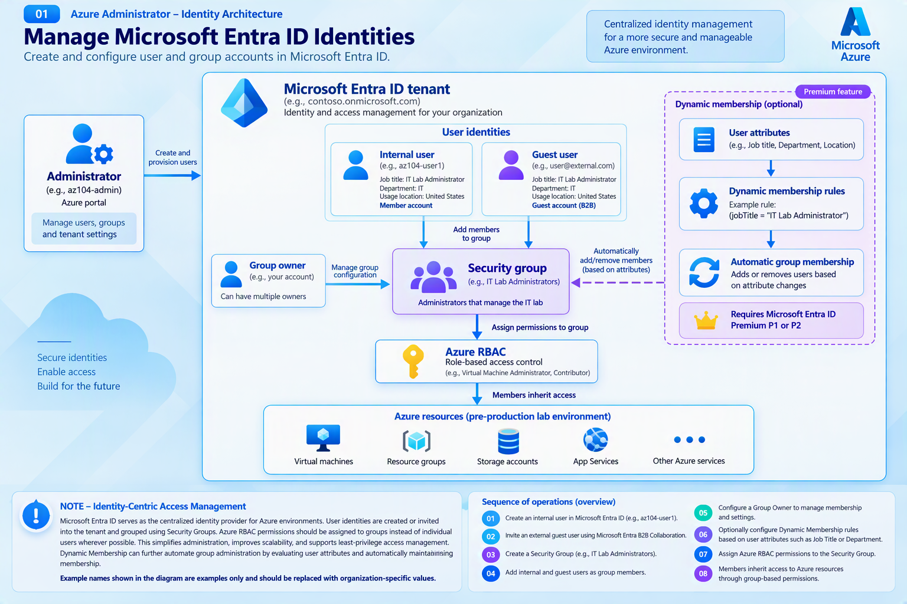

# Lab 01 | Manage Microsoft Entra identities and groups

> **AZ-104: Microsoft Azure Administrator**  
> Conceptual architecture and service-flow reference.

## Overview

This reference explains the Azure services, responsibilities, and end-to-end flow behind **Manage Microsoft Entra identities and groups**.

## Azure Services Involved

### Microsoft Entra ID

Microsoft Entra ID contributes a specific capability to this architecture. Its configuration should be validated against the required scope, security boundary, and operational outcome.

### Users

Users contributes a specific capability to this architecture. Its configuration should be validated against the required scope, security boundary, and operational outcome.

### Security groups

Security groups contributes a specific capability to this architecture. Its configuration should be validated against the required scope, security boundary, and operational outcome.

### Administrative roles

Administrative roles contributes a specific capability to this architecture. Its configuration should be validated against the required scope, security boundary, and operational outcome.

## What We Are Trying to Achieve

Create a manageable identity structure for Azure administration while keeping identity-directory roles separate from Azure resource permissions.

## Architecture Diagram

> Azure service-flow.

## How the Services Work Together

The architecture separates the management plane, identity and authorization decisions, resource configuration, workload traffic, and monitoring. Each arrow in the final diagram should identify the operation or data flow rather than merely connect two boxes.

## Flow Sequence

### 01 | An administrator creates or manages user identities in Microsoft Entra ID.

### 02 | Users are collected into security groups according to access requirements.

### 03 | Microsoft Entra roles authorize directory administration tasks.

### 04 | Azure RBAC role assignments authorize access to Azure resources at a defined scope.

### 05 | Group-based assignments simplify onboarding and access changes.

### 06 | The administrator validates effective membership and permissions.

## Hands-on Reference

[Open the hands-on reference]([https://example.com/az-104/lab-01](https://youtu.be/E8USciNUryE?si=7MWj57x3Bwt6nWD5))

## Key Takeaways

- Use the correct Azure service for the required control-plane or data-plane responsibility.
- Apply least privilege at the narrowest practical scope.
- Treat example resource names as examples, not mandatory Azure names.
- Validate dependencies, traffic direction, inherited access, monitoring, and recovery behavior.
- Keep the architecture page conceptual and place procedural steps in the hands-on reference.
