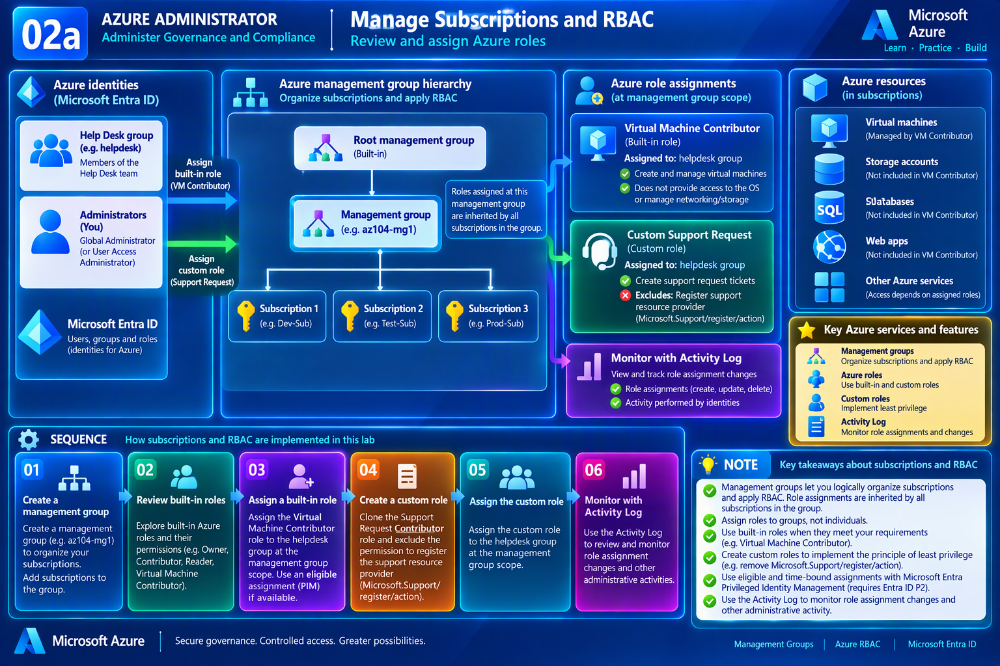

# Lab 02 | Manage subscriptions and Azure RBAC

> **AZ-104: Microsoft Azure Administrator**  
> Conceptual architecture and service-flow reference.

## Overview

This reference explains the Azure services, responsibilities, and end-to-end flow behind **Manage subscriptions and Azure RBAC**.

## Azure Services Involved

### Azure subscriptions

Azure subscriptions contributes a specific capability to this architecture. Its configuration should be validated against the required scope, security boundary, and operational outcome.

### Management groups

Management groups contributes a specific capability to this architecture. Its configuration should be validated against the required scope, security boundary, and operational outcome.

### Azure RBAC

Azure RBAC contributes a specific capability to this architecture. Its configuration should be validated against the required scope, security boundary, and operational outcome.

### Resource groups

Resource groups contributes a specific capability to this architecture. Its configuration should be validated against the required scope, security boundary, and operational outcome.

## What We Are Trying to Achieve

Organize Azure resources into governance scopes and grant least-privilege access through role assignments.

## Architecture Diagram

> Azure service-flow.

## How the Services Work Together

The architecture separates the management plane, identity and authorization decisions, resource configuration, workload traffic, and monitoring. Each arrow in the final diagram should identify the operation or data flow rather than merely connect two boxes.

## Flow Sequence

### 01 | Subscriptions are placed under the appropriate management-group hierarchy.

### 02 | Resource groups provide lifecycle and access boundaries for related resources.

### 03 | A security principal is selected: user, group, service principal, or managed identity.

### 04 | A role definition supplies the permitted management-plane actions.

### 05 | The assignment joins principal, role, and scope.

### 06 | Effective access includes direct assignments plus inherited assignments from parent scopes.

## Hands-on Reference

[Open the hands-on reference](https://youtu.be/Fnfq9tXMNqI?si=WKH6-WF8ZL8s3hmc)

## Key Takeaways

- Use the correct Azure service for the required control-plane or data-plane responsibility.
- Apply least privilege at the narrowest practical scope.
- Treat example resource names as examples, not mandatory Azure names.
- Validate dependencies, traffic direction, inherited access, monitoring, and recovery behavior.
- Keep the architecture page conceptual and place procedural steps in the hands-on reference.
