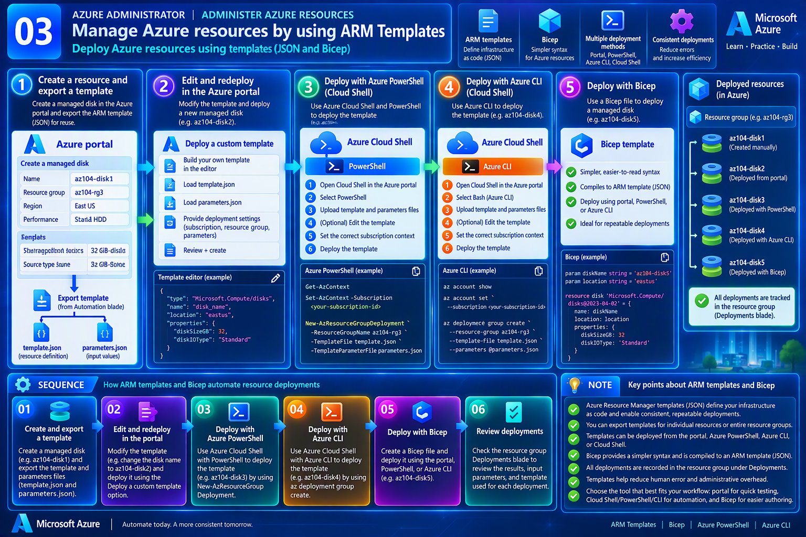

# Lab 03 | Manage Azure resources with Azure Resource Manager

> **AZ-104: Microsoft Azure Administrator**  
> Conceptual architecture and service-flow reference.

## Overview

This reference explains the Azure services, responsibilities, and end-to-end flow behind **Manage Azure resources with Azure Resource Manager**.

## Azure Services Involved

### Azure Resource Manager

Azure Resource Manager contributes a specific capability to this architecture. Its configuration should be validated against the required scope, security boundary, and operational outcome.

### Resource groups

Resource groups contributes a specific capability to this architecture. Its configuration should be validated against the required scope, security boundary, and operational outcome.

### ARM templates

ARM templates contributes a specific capability to this architecture. Its configuration should be validated against the required scope, security boundary, and operational outcome.

### Resource locks

Resource locks contributes a specific capability to this architecture. Its configuration should be validated against the required scope, security boundary, and operational outcome.

### Azure tags

Azure tags contributes a specific capability to this architecture. Its configuration should be validated against the required scope, security boundary, and operational outcome.

## What We Are Trying to Achieve

Deploy, organize, protect, and consistently describe Azure resources through the Azure control plane.

## Architecture Diagram

## How the Services Work Together

The architecture separates the management plane, identity and authorization decisions, resource configuration, workload traffic, and monitoring. Each arrow in the final diagram should identify the operation or data flow rather than merely connect two boxes.

## Flow Sequence

### 01 | A deployment request is submitted through the portal, CLI, PowerShell, or an ARM template.

### 02 | Azure Resource Manager authenticates the caller and evaluates Azure RBAC.

### 03 | The resource provider validates and creates the requested resource.

### 04 | Resources are grouped by shared lifecycle in resource groups.

### 05 | Tags add operational metadata for cost, ownership, or environment.

### 06 | Resource locks help prevent accidental deletion or modification.

## Hands-on Reference

[Open the hands-on reference](https://youtu.be/7vBpiBPsHwE?si=om9O2JFcxrZ-siYg)

## Key Takeaways

- Use the correct Azure service for the required control-plane or data-plane responsibility.
- Apply least privilege at the narrowest practical scope.
- Treat example resource names as examples, not mandatory Azure names.
- Validate dependencies, traffic direction, inherited access, monitoring, and recovery behavior.
- Keep the architecture page conceptual and place procedural steps in the hands-on reference.
