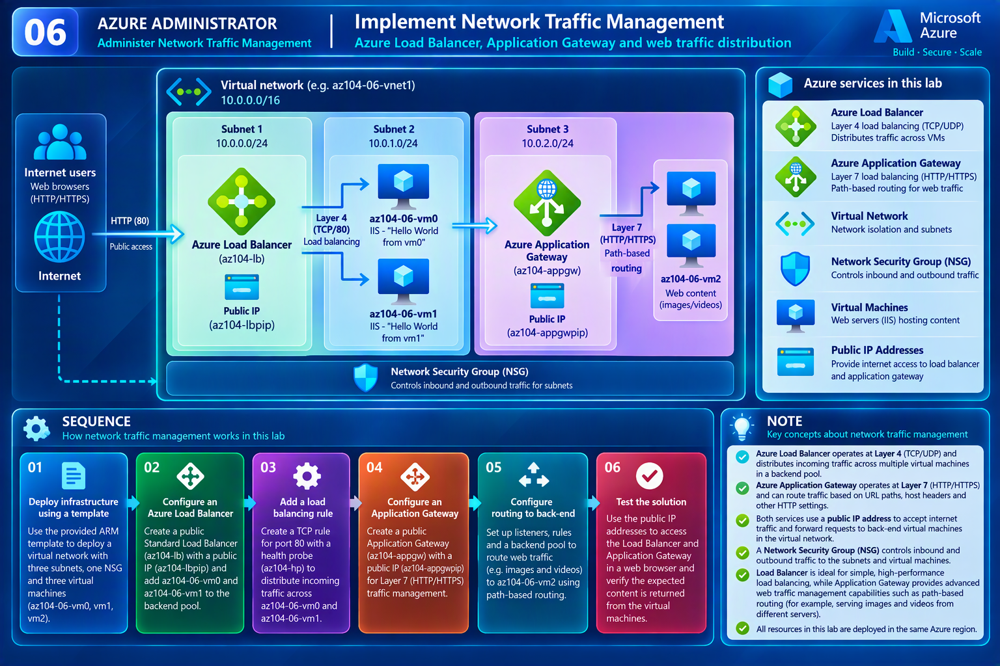

# Lab 06 | Implement network traffic management

> **AZ-104: Microsoft Azure Administrator**  
> Conceptual architecture and service-flow reference. This page is **not a step-by-step lab instruction**.

## Overview

This reference explains the Azure services, responsibilities, and end-to-end flow behind **Implement network traffic management**.

## Azure Services Involved

### Azure Load Balancer

Azure Load Balancer contributes a specific capability to this architecture. Its configuration should be validated against the required scope, security boundary, and operational outcome.

### Azure Application Gateway

Azure Application Gateway contributes a specific capability to this architecture. Its configuration should be validated against the required scope, security boundary, and operational outcome.

### Backend pools

Backend pools contributes a specific capability to this architecture. Its configuration should be validated against the required scope, security boundary, and operational outcome.

### Health probes

Health probes contributes a specific capability to this architecture. Its configuration should be validated against the required scope, security boundary, and operational outcome.

### Network security groups

Network security groups contributes a specific capability to this architecture. Its configuration should be validated against the required scope, security boundary, and operational outcome.

## What We Are Trying to Achieve

Distribute client requests across healthy back-end workloads using the correct Layer 4 or Layer 7 service.

## Architecture Diagram

## How the Services Work Together

The architecture separates the management plane, identity and authorization decisions, resource configuration, workload traffic, and monitoring. Each arrow in the final diagram should identify the operation or data flow rather than merely connect two boxes.

## Flow Sequence

### 01 | Internet traffic reaches a public frontend IP.

### 02 | Azure Load Balancer distributes TCP or UDP flows to healthy backend instances.

### 03 | A health probe removes unavailable instances from rotation.

### 04 | Application Gateway terminates and evaluates HTTP or HTTPS requests.

### 05 | Listeners and routing rules select the correct web backend.

### 06 | Monitoring and browser tests confirm the expected response path.

## Hands-on Reference

[Open the hands-on reference](https://youtu.be/wGd8PnWYFEw?si=UpSCiGeEFuISDxjn)

## Key Takeaways

- Use the correct Azure service for the required control-plane or data-plane responsibility.
- Apply least privilege at the narrowest practical scope.
- Treat example resource names as examples, not mandatory Azure names.
- Validate dependencies, traffic direction, inherited access, monitoring, and recovery behavior.
- Keep the architecture page conceptual and place procedural steps in the hands-on reference.
