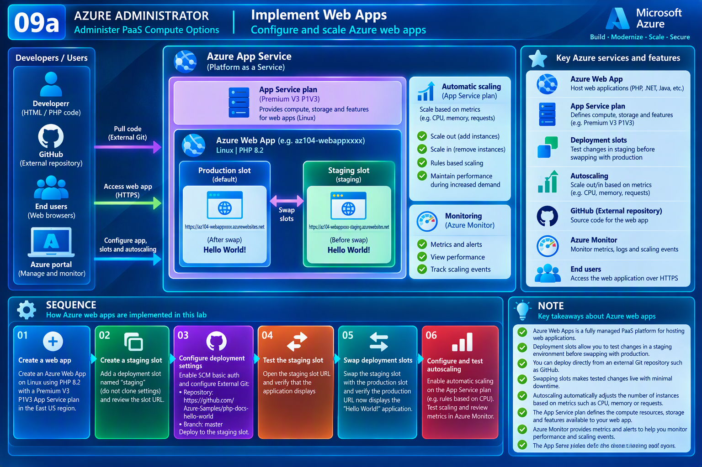

# Lab 09a | Implement Azure Web Apps

> **AZ-104: Microsoft Azure Administrator**  
> Conceptual architecture and service-flow reference.

## Overview

This reference explains the Azure services, responsibilities, and end-to-end flow behind **Implement Azure Web Apps**.

## Azure Services Involved

### Azure App Service

Azure App Service contributes a specific capability to this architecture. Its configuration should be validated against the required scope, security boundary, and operational outcome.

### App Service plan

App Service plan contributes a specific capability to this architecture. Its configuration should be validated against the required scope, security boundary, and operational outcome.

### Deployment slots

Deployment slots contributes a specific capability to this architecture. Its configuration should be validated against the required scope, security boundary, and operational outcome.

### GitHub

GitHub contributes a specific capability to this architecture. Its configuration should be validated against the required scope, security boundary, and operational outcome.

### Azure Monitor

Azure Monitor contributes a specific capability to this architecture. Its configuration should be validated against the required scope, security boundary, and operational outcome.

## What We Are Trying to Achieve

Host a managed web application, validate changes in staging, and release them with a controlled slot swap.

## Architecture Diagram

> Add the final Azure service-flow image at `images/lab-09a/architecture.png`.

## How the Services Work Together

The architecture separates the management plane, identity and authorization decisions, resource configuration, workload traffic, and monitoring. Each arrow in the final diagram should identify the operation or data flow rather than merely connect two boxes.

## Flow Sequence

### 01 | An App Service plan provides the compute capacity and feature tier.

### 02 | The web app runs the selected runtime on the managed platform.

### 03 | Source is deployed from a repository to a staging slot.

### 04 | The staging endpoint is tested independently from production.

### 05 | A slot swap promotes the validated release to production.

### 06 | Azure Monitor and autoscale maintain visibility and capacity.

## Hands-on Reference

[Open the hands-on reference](https://youtu.be/E-J7KenHnfs?si=cv3fZBA651NRV_Ec)

## Key Takeaways

- Use the correct Azure service for the required control-plane or data-plane responsibility.
- Apply least privilege at the narrowest practical scope.
- Treat example resource names as examples, not mandatory Azure names.
- Validate dependencies, traffic direction, inherited access, monitoring, and recovery behavior.
- Keep the architecture page conceptual and place procedural steps in the hands-on reference.
