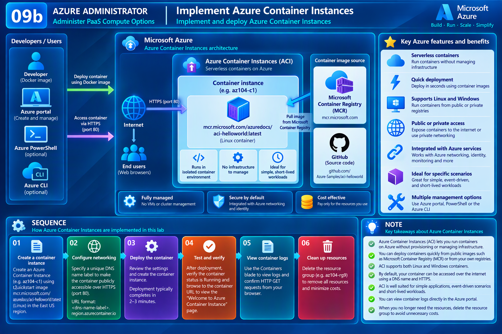

# Lab 09b | Implement Azure Container Instances

> **AZ-104: Microsoft Azure Administrator**  
> Conceptual architecture and service-flow reference.

## Overview

This reference explains the Azure services, responsibilities, and end-to-end flow behind **Implement Azure Container Instances**.

## Azure Services Involved

### Azure Container Instances

Azure Container Instances contributes a specific capability to this architecture. Its configuration should be validated against the required scope, security boundary, and operational outcome.

### Microsoft Container Registry

Microsoft Container Registry contributes a specific capability to this architecture. Its configuration should be validated against the required scope, security boundary, and operational outcome.

### Container groups

Container groups contributes a specific capability to this architecture. Its configuration should be validated against the required scope, security boundary, and operational outcome.

### Public DNS and IP

Public DNS and IP contributes a specific capability to this architecture. Its configuration should be validated against the required scope, security boundary, and operational outcome.

### Azure Monitor

Azure Monitor contributes a specific capability to this architecture. Its configuration should be validated against the required scope, security boundary, and operational outcome.

## What We Are Trying to Achieve

Run a container image without provisioning virtual machines or managing a cluster.

## Architecture Diagram

> Add the final Azure service-flow image at `images/lab-09b/architecture.png`.

## How the Services Work Together

The architecture separates the management plane, identity and authorization decisions, resource configuration, workload traffic, and monitoring. Each arrow in the final diagram should identify the operation or data flow rather than merely connect two boxes.

## Flow Sequence

### 01 | Select a public or private container image.

### 02 | Create a container instance with CPU, memory, OS, and restart settings.

### 03 | Azure pulls the image and starts the container in an isolated environment.

### 04 | Ingress exposes the required port through a public IP and DNS label when configured.

### 05 | Users send requests to the container endpoint.

### 06 | Logs and state are reviewed, then temporary resources are removed.

## Hands-on Reference

[Open the hands-on reference](https://youtu.be/612P8fbRHdQ?si=i66SkaiNtB632v6F)

## Key Takeaways

- Use the correct Azure service for the required control-plane or data-plane responsibility.
- Apply least privilege at the narrowest practical scope.
- Treat example resource names as examples, not mandatory Azure names.
- Validate dependencies, traffic direction, inherited access, monitoring, and recovery behavior.
- Keep the architecture page conceptual and place procedural steps in the hands-on reference.
