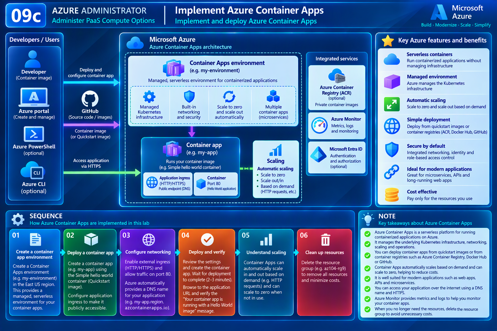

# Lab 09c | Implement Azure Container Apps

> **AZ-104: Microsoft Azure Administrator**  
> Conceptual architecture and service-flow reference.

## Overview

This reference explains the Azure services, responsibilities, and end-to-end flow behind **Implement Azure Container Apps**.

## Azure Services Involved

### Azure Container Apps

Azure Container Apps contributes a specific capability to this architecture. Its configuration should be validated against the required scope, security boundary, and operational outcome.

### Container Apps environment

Container Apps environment contributes a specific capability to this architecture. Its configuration should be validated against the required scope, security boundary, and operational outcome.

### Ingress

Ingress contributes a specific capability to this architecture. Its configuration should be validated against the required scope, security boundary, and operational outcome.

### Revisions and replicas

Revisions and replicas contributes a specific capability to this architecture. Its configuration should be validated against the required scope, security boundary, and operational outcome.

### Azure Monitor

Azure Monitor contributes a specific capability to this architecture. Its configuration should be validated against the required scope, security boundary, and operational outcome.

## What We Are Trying to Achieve

Run a long-lived containerized web workload on a managed, serverless application platform.

## Architecture Diagram

> Add the final Azure service-flow image at `images/lab-09c/architecture.png`.

## How the Services Work Together

The architecture separates the management plane, identity and authorization decisions, resource configuration, workload traffic, and monitoring. Each arrow in the final diagram should identify the operation or data flow rather than merely connect two boxes.

## Flow Sequence

### 01 | Create a Container Apps environment as the managed boundary.

### 02 | Deploy a container app from the quickstart or chosen registry image.

### 03 | Configure external ingress and the target application port.

### 04 | Azure creates a revision and starts one or more replicas.

### 05 | HTTP requests reach the generated application endpoint.

### 06 | Metrics and demand can drive scale-out, scale-in, and scale-to-zero behavior.

## Hands-on Reference

[Open the hands-on reference](lab-09b-implement-azure-container-instances)

## Key Takeaways

- Use the correct Azure service for the required control-plane or data-plane responsibility.
- Apply least privilege at the narrowest practical scope.
- Treat example resource names as examples, not mandatory Azure names.
- Validate dependencies, traffic direction, inherited access, monitoring, and recovery behavior.
- Keep the architecture page conceptual and place procedural steps in the hands-on reference.
