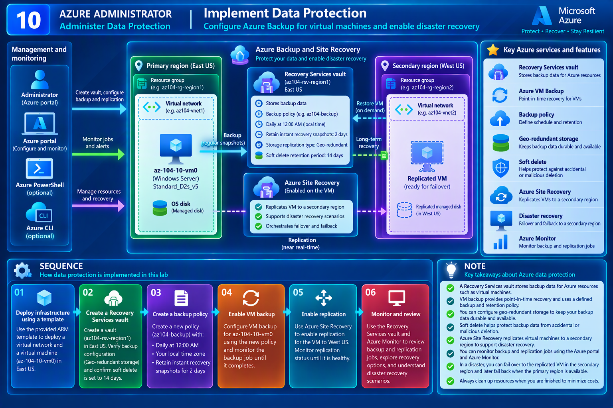

# Lab 10 | Implement data protection

> **AZ-104: Microsoft Azure Administrator**  
> Conceptual architecture and service-flow reference.

## Overview

This reference explains the Azure services, responsibilities, and end-to-end flow behind **Implement data protection**.

## Azure Services Involved

### Recovery Services vault

Recovery Services vault contributes a specific capability to this architecture. Its configuration should be validated against the required scope, security boundary, and operational outcome.

### Azure Backup

Azure Backup contributes a specific capability to this architecture. Its configuration should be validated against the required scope, security boundary, and operational outcome.

### Backup policies

Backup policies contributes a specific capability to this architecture. Its configuration should be validated against the required scope, security boundary, and operational outcome.

### Soft delete

Soft delete contributes a specific capability to this architecture. Its configuration should be validated against the required scope, security boundary, and operational outcome.

### Azure Site Recovery

Azure Site Recovery contributes a specific capability to this architecture. Its configuration should be validated against the required scope, security boundary, and operational outcome.

## What We Are Trying to Achieve

Protect an Azure virtual machine with recoverable backups and prepare for regional disaster recovery.

## Architecture Diagram

## How the Services Work Together

The architecture separates the management plane, identity and authorization decisions, resource configuration, workload traffic, and monitoring. Each arrow in the final diagram should identify the operation or data flow rather than merely connect two boxes.

## Flow Sequence

### 01 | Create a Recovery Services vault in the protection region.

### 02 | Define the VM backup schedule and retention policy.

### 03 | Enable protection and create recovery points.

### 04 | Soft delete protects backup items against premature deletion.

### 05 | Site Recovery replicates VM state to a secondary region.

### 06 | Monitor health and use restore, failover, or failback according to the recovery scenario.

## Hands-on Reference

[Open the hands-on reference](https://youtu.be/_-ZU0WrezjU?si=R1aufkJfMZRRlIjw)

## Key Takeaways

- Use the correct Azure service for the required control-plane or data-plane responsibility.
- Apply least privilege at the narrowest practical scope.
- Treat example resource names as examples, not mandatory Azure names.
- Validate dependencies, traffic direction, inherited access, monitoring, and recovery behavior.
- Keep the architecture page conceptual and place procedural steps in the hands-on reference.
